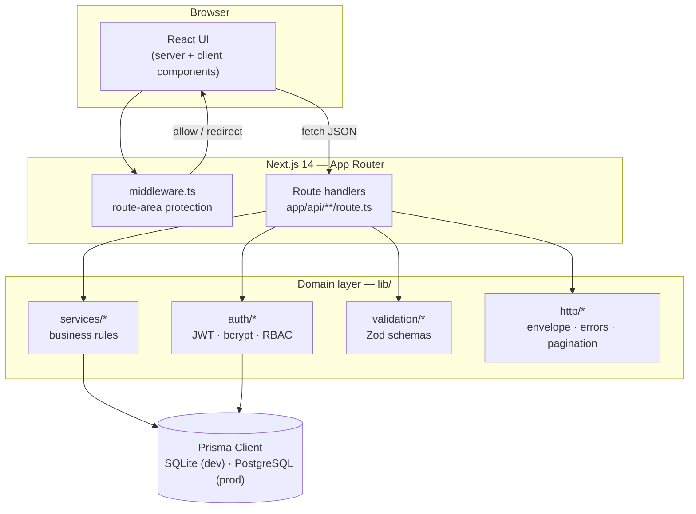

# Student Management System

A full-stack student information system for universities, colleges and secondary schools — managing students, staff, academics, enrolments, assessments, attendance and fees behind role-based access for administrators, lecturers and students.

[](LICENSE)
[](https://nextjs.org)
[](https://www.typescriptlang.org)
[](https://www.prisma.io)
[](https://tailwindcss.com)

---

## Overview

Institutions typically run on disconnected spreadsheets, offline records and ad-hoc email for the day-to-day administration of academic life. That arrangement makes it hard to answer routine questions — who is enrolled, who is teaching what, who owes fees, who has been attending — and nearly impossible to enforce consistent access rules.

This project is a single, self-contained web application that centralises those workflows. Every entity an institution needs (faculties, departments, programmes, courses, academic sessions, semesters, staff, students, enrolments, assessments, scores, attendance, fees and announcements) is modelled in one normalised relational schema and exposed through a REST API and a role-scoped interface.

It is built as a Next.js 14 App Router application with a layered backend (`route handler → service → Prisma`), strict TypeScript, Zod validation shared between client and server, and JWT session cookies. Security is treated as a first-class concern: authorisation is enforced server-side on every request, ownership checks prevent IDOR, and administrative actions are written to an append-only audit log.

## Table of contents

- [Key features](#key-features)
- [Architecture](#architecture)
- [Technology stack](#technology-stack)
- [Project structure](#project-structure)
- [Getting started](#getting-started)
- [Demo accounts](#demo-accounts)
- [Usage](#usage)
- [API reference](#api-reference)
- [Testing and code quality](#testing-and-code-quality)
- [Configuration](#configuration)
- [Security](#security)
- [Deployment](#deployment)
- [Limitations and roadmap](#limitations-and-roadmap)
- [Contributing](#contributing)
- [License](#license)

## Key features

### Role-based portals

Three roles, each with a dedicated area enforced by middleware and re-checked on every server request.

- **Admin** — dashboards with institution-wide metrics; CRUD for students, staff, faculties, departments, programmes, courses, academic sessions, semesters, enrolments, assessments and fees; configurable grading rules; user and role management; announcement authoring; and a paginated audit log.
- **Lecturer** — dashboard scoped to assigned courses; assessment creation; score entry with grade-history tracking; attendance recording; course performance views; and course announcements.
- **Student** — dashboard with current term, registered courses, GPA/CGPA, attendance percentage and upcoming assessments; plus dedicated pages for courses, weekly timetable, results, attendance, fees, announcements and profile.

### Academic and assessment management

- Normalised academic hierarchy: **Faculty → Department → Programme → Course**, tied to **Academic Session → Semester**.
- Enrolment with duplicate prevention enforced at the database level via a composite unique constraint, and a bulk-enrol endpoint that reports skipped duplicates.
- Flexible assessments (assignment, test, quiz, midterm, exam, project) with per-course weights that are capped at 100%.
- Score entry with validation (no scores above the assessment maximum or below zero) and an append-only `GradeHistory` record whenever a score changes.
- **Configurable grading rules** — ordered score bands mapping to a grade and grade points drive letter grades and GPA, rather than a hard-coded scale. Institutions can add their own named grading sets.
- Idempotent daily attendance (present, absent, late, excused) with accurate percentage calculation that excludes excused absences.

### Fees and payments

- One fee record per student per session, with payments recorded against it.
- Overpayment is rejected and payment references are unique.

### Platform behaviour

- Uniform JSON API envelope, server-side pagination (1–100 per page), whitelisted sorting, search and resource-specific filters.
- Reusable, declarative UI: a generic `DataTable` (search, sort, pagination, row actions, bulk actions, loading/empty/error states) and a `ResourceForm` (shared Zod validation, server error mapping, submit locking).
- Consistent UX states: toasts, confirmation dialogs for destructive actions, skeletons and empty states, and accessibility affordances (labelled inputs, `aria-invalid`, keyboard-operable dialogs, visible focus rings, skip-to-content link).

### Not yet implemented

There is no CI/CD workflow or Docker image in the repository, no browser-based end-to-end test suite, and no email or file-upload integration. See [Limitations and roadmap](#limitations-and-roadmap).

## Architecture

The application follows a strict layering rule: **route handlers own HTTP, services own business rules, and Prisma owns persistence.** Route handlers parse input, authorise the caller and choose status codes; they never contain domain logic. Services are pure TypeScript and can be unit-tested without a running server.



**Authentication flow.** `POST /api/auth/login` verifies the bcrypt hash and issues two httpOnly cookies: `sms_at` (access, 15m) and `sms_rt` (refresh, 7d). Server components resolve the session through `getSession()`, which verifies the access token and falls back to the refresh token so server-rendered pages stay coherent. The client API wrapper transparently refreshes once on a `401` and retries. The user row is re-read on every session resolution, so a suspended account or a role change takes effect immediately rather than at token expiry.

**Authorisation.** `middleware.ts` performs a coarse route-area guard by verifying the JWT signature at the edge. It is explicitly *not* the authorisation boundary — every API route calls `requireSession()` or `requireRole(...)` and re-checks the caller's current role and status against the database. Student endpoints resolve the caller's own `StudentProfile` from the session and scope queries by it; lecturers may only touch their assigned courses.

More detail, including the decision log and security trade-offs, is in [`docs/ARCHITECTURE.md`](docs/ARCHITECTURE.md).

## Technology stack

| Category | Technology | Role in the project |
| --- | --- | --- |
| Language & runtime | TypeScript (strict), Node.js | Application and tooling language |
| Framework | Next.js 14 (App Router) | SSR, route handlers, middleware, code splitting |
| UI | React 18, Tailwind CSS 3 | Server/client components and styling with CSS-variable design tokens |
| Data access | Prisma 5 | Typed client and migrations; SQLite (dev) / PostgreSQL (prod) |
| Validation | Zod 4 | Schemas shared between client and server |
| Auth | `jose` (JWT, HS256), `bcryptjs` | Signed session cookies and password hashing |
| Testing | Vitest 2 | Unit and service/integration tests against a disposable SQLite database |
| Quality | ESLint (`eslint-config-next`), `tsc --noEmit` | Linting and the authoritative type gate |
| Tooling | `tsx` | Running the TypeScript seed script |

No machine-learning, cloud, or container dependencies are used.

## Project structure

```text
.
├── app/
│   ├── (auth)/login/                 # Public login page and form
│   ├── (dashboard)/                  # Authenticated shell (sidebar + topbar)
│   │   ├── admin/                    # Admin area: 20 pages
│   │   ├── lecturer/                 # Lecturer area
│   │   └── student/                  # Student area
│   ├── api/                          # REST route handlers (56 endpoints)
│   ├── layout.tsx globals.css        # Root layout and global styles
│   └── page.tsx                      # Role-aware landing redirect
├── components/
│   ├── ui/                           # Primitives: Button, Input, Card, Modal, Toast, …
│   ├── data-table/                   # Generic DataTable + resource table
│   ├── forms/                        # Declarative ResourceForm + field renderer
│   ├── layout/                       # AppShell, Sidebar, Topbar, navigation config
│   └── features/                     # ScoreEntryGrid, AttendanceRecorder, Gradebook
├── lib/
│   ├── auth/                         # password, tokens, session, rbac
│   ├── http/                         # errors, response envelope, handler wrapper, pagination
│   ├── validation/                   # Zod schemas (shared client/server)
│   ├── services/                     # Domain/business logic (19 services)
│   ├── security/                     # rate limiting, origin checks
│   ├── domain/                       # enums and grading logic
│   └── audit.ts db.ts env.ts api-client.ts utils.ts
├── prisma/
│   ├── schema.prisma                 # 20-model normalised schema
│   ├── migrations/                   # SQL migrations
│   └── seed.ts                       # Deterministic demo dataset
├── tests/
│   ├── unit/                         # Grading, auth, pagination, rate limit, tokens
│   ├── integration/                  # Auth, students, enrolments, scores, attendance
│   └── helpers/ global-setup.ts
├── docs/
│   ├── ARCHITECTURE.md               # Architecture and decision log
│   └── API.md                        # Full endpoint reference
├── middleware.ts                     # Edge route-area protection
└── next.config.mjs                   # Security headers / CSP
```

## Getting started

### Prerequisites

- **Node.js 18.17 or newer** (required by Next.js 14.2) and **npm**.
- No external database is required for development — the default datasource is a local SQLite file.

### 1. Clone the repository

```bash
git clone https://github.com/charlesakinnurun/codealpha-student-management-system.git
cd codealpha-student-management-system
```

### 2. Install dependencies

```bash
npm install
```

### 3. Configure environment variables

Copy the example file and adjust it. On macOS/Linux:

```bash
cp .env.example .env
```

On Windows (PowerShell):

```powershell
Copy-Item .env.example .env
```

Generate a strong `JWT_SECRET` (the app fails fast at boot if it is shorter than 32 characters):

```bash
node -e "console.log(require('crypto').randomBytes(32).toString('hex'))"
```

Then edit `.env` and set `JWT_SECRET` to the generated value. The remaining variables are described in [Configuration](#configuration). The `.env` file is git-ignored and must never be committed.

### 4. Create the database and seed demo data

```bash
npm run db:migrate   # apply migrations (prisma migrate dev)
npm run db:seed      # wipe and load a deterministic demo institution
```

### 5. Start the development server

```bash
npm run dev
```

Open <http://localhost:3000>. The landing route redirects to `/login`, and after signing in, to the dashboard for your role.

### Production build

```bash
npm run build        # prisma generate && next build
npm start            # next start
```

## Demo accounts

`npm run db:seed` loads a small but realistic institution (3 faculties, 4 departments, 4 programmes, 2 academic sessions, courses, staff, students, enrolments, assessments, scores, attendance, fees and announcements). Every seeded account shares the password:

```text
Password1
```

| Role | Email |
| --- | --- |
| Admin | `admin@school.edu` |
| Lecturer | `ada.okoro@school.edu` |
| Lecturer | `john.mensah@school.edu` |
| Lecturer | `grace.adeyemi@school.edu` |
| Student | `chinedu.okafor@student.school.edu` |

Student addresses follow `firstname.lastname@student.school.edu` for the 12 seeded students. These credentials are for local development only.

## Usage

### Web application

1. Sign in at `/login` with one of the demo accounts above.
2. You are redirected to the dashboard for your role. Navigation is defined per role in `components/layout/nav-config.ts`.
3. As an admin you can, for example, create a faculty under **Faculties**, add a student under **Students**, and enrol them under **Enrolments**. All mutations validate on the server and surface field-level errors in the form.

### API

Every endpoint lives under `/api` and returns a uniform envelope:

```jsonc
// success (single)
{ "data": { /* … */ } }

// success (list)
{ "data": [ /* … */ ], "meta": { "page": 1, "pageSize": 20, "total": 137, "totalPages": 7 } }

// error
{ "error": { "code": "VALIDATION_ERROR", "message": "Validation failed", "details": [ { "path": "email", "message": "…" } ] } }
```

Authenticate and capture the session cookies:

```bash
curl -i -c cookies.txt -X POST http://localhost:3000/api/auth/login \
  -H "Content-Type: application/json" \
  -d '{"email":"admin@school.edu","password":"Password1"}'
```

Then call an authenticated endpoint with the saved cookies:

```bash
curl -b cookies.txt "http://localhost:3000/api/students?page=1&pageSize=20&q=okafor&status=ACTIVE"
```

List endpoints accept `page`, `pageSize` (1–100), `q`, `sort` (whitelisted per resource), `order` (`asc` | `desc`) plus resource-specific filters.

## API reference

The full, per-endpoint reference — methods, paths, allowed roles, filters and status codes — is maintained in [`docs/API.md`](docs/API.md). Summary of the surface:

| Group | Examples |
| --- | --- |
| Auth | `POST /api/auth/login`, `POST /api/auth/logout`, `POST /api/auth/refresh`, `GET /api/auth/me` |
| Health | `GET /api/health` |
| Students & staff | `GET/POST /api/students`, `GET/PATCH/DELETE /api/students/:id`, `…/staff` |
| Academic structure | `/faculties`, `/departments`, `/programs`, `/sessions`, `/semesters` |
| Courses | `/courses`, `/courses/:id/gradebook`, `/courses/:id/attendance`, `/course-assignments` |
| Enrolments | `/enrollments`, `/enrollments/bulk` |
| Assessments & grading | `/assessments`, `/assessments/:id/scores`, `/assessments/:id/publish`, `/scores`, `/scores/bulk`, `/grading-rules` |
| Attendance | `GET /api/attendance`, `PUT /api/attendance` (bulk, idempotent) |
| Fees & payments | `/fees`, `/payments` |
| Announcements | `/announcements`, `/announcements/:id` |
| Admin | `/users`, `/audit-logs`, `/dashboard/{admin,lecturer,student}` |
| Student self-service | `/me/profile`, `/me/courses`, `/me/results`, `/me/attendance`, `/me/fees`, `/me/timetable` |

**Status codes:** `200`, `201`, `204`, `400` validation, `401` unauthenticated, `403` forbidden, `404` not found, `409` conflict, `422` business-rule violation, `429` rate limited, `500` unexpected.

## Testing and code quality

```bash
npm test           # Vitest: unit + service/integration suites
npm run test:watch # Watch mode
npm run typecheck  # tsc --noEmit
npm run lint       # ESLint (next lint)
```

Integration tests run against a disposable SQLite database (`prisma/test.db`) created and reset in `tests/global-setup.ts`, so they exercise the real schema constraints rather than mocks. File-level parallelism is disabled because the suite shares one database file.

Coverage includes grading/GPA/attendance calculations, pagination parsing, password hashing and the RBAC matrix (unit), plus student CRUD and uniqueness, duplicate-enrolment prevention, score validation and grade history, and attendance idempotency (integration).

> Test result as run during authoring of this document: **10 test files, 72 tests, all passing.** No CI workflow currently runs these checks automatically.

## Configuration

All variables are validated at boot by [`lib/env.ts`](lib/env.ts); a misconfiguration fails fast with an actionable message rather than surfacing deep inside a request.

| Variable | Required | Default | Description |
| --- | --- | --- | --- |
| `DATABASE_URL` | Yes | — | Prisma connection string. `file:./dev.db` for SQLite; a `postgresql://…` URL in production. |
| `JWT_SECRET` | Yes | — | Signing key for session JWTs. Minimum 32 characters. |
| `JWT_EXPIRES_IN` | No | `15m` | Access-token lifetime. |
| `REFRESH_TOKEN_EXPIRES_IN` | No | `7d` | Refresh-token lifetime. |
| `NEXT_PUBLIC_APP_NAME` | No | `Student Management System` | Application name shown in metadata. |
| `NODE_ENV` | No | `development` | Standard Node environment. |

See [`.env.example`](.env.example) for a copy-paste template. Never commit real secrets; `.env` and `.env*.local` are git-ignored.

## Security

- **Passwords** are hashed with bcrypt (cost 12) and never returned by any API.
- **Sessions** use httpOnly, `SameSite=Lax` cookies (`Secure` in production), with access/refresh token rotation.
- **Authorisation** is enforced server-side on every request (`requireSession` / `requireRole`); the UI only reflects capabilities. Client-side checks are never trusted.
- **IDOR protection**: student endpoints resolve the caller's own profile from the session; lecturers are scoped to their assigned courses.
- **Input validation** via Zod on every mutation, with field-level error responses.
- **SQL injection** is prevented by Prisma's parameterised queries — no raw SQL is used (except the `SELECT 1` health probe).
- **XSS** is mitigated by React's output escaping and a Content-Security-Policy; **CSRF** by `SameSite=Lax` cookies plus an `Origin` header check on mutating requests.
- **Rate limiting** on authentication endpoints (10 requests/minute/IP, fixed window).
- **Audit logging**: administrative actions and authentication events are written to an append-only `AuditLog`; grade edits are tracked in `GradeHistory`.
- **Login errors are generic** to prevent user enumeration, and suspended accounts are blocked.
- Clickjacking and MIME-sniffing are addressed through `X-Frame-Options`, `frame-ancestors 'none'`, `X-Content-Type-Options` and related headers in [`next.config.mjs`](next.config.mjs).

To report a vulnerability, follow [`SECURITY.md`](SECURITY.md).

## Deployment

The application is a standard Next.js server and is deployed as such. There is **no Dockerfile or CI/CD workflow committed**, so the steps below are the supported manual process.

1. Provision PostgreSQL and set `DATABASE_URL` to it.
2. In `prisma/schema.prisma`, change the datasource `provider` from `sqlite` to `postgresql`, then regenerate migrations for the target database.
3. Install and build:

   ```bash
   npm ci
   npx prisma migrate deploy
   npm run build
   ```

4. Start behind TLS:

   ```bash
   npm start
   ```

Set `NODE_ENV=production` so `Secure` cookies and HSTS are enabled. The `GET /api/health` endpoint is suitable as a liveness/readiness probe. Note that the in-memory rate limiter is per-instance (see below), which matters for horizontally scaled deployments.

## Limitations and roadmap

Known limitations, documented deliberately rather than overlooked:

- **In-memory rate limiting** (`lib/security/rate-limit.ts`) is fixed-window and per-instance. A multi-instance deployment needs a shared store such as Redis.
- **CSP uses `'unsafe-inline'` for `script-src`** because the App Router emits inline bootstrap scripts. A per-request nonce is the recommended next step; remote script origins are already blocked.
- **SQLite is the default datasource** for zero-configuration development; production requires the PostgreSQL provider swap and regenerated migrations.
- **"Class" is represented, not duplicated** — a teaching group is a course plus session, semester and level, joined to students through enrolment (no separate `Class` table).
- **Hard deletes** are used; soft state is handled with explicit `status` fields rather than ORM-level soft delete.
- **No CI/CD or containerisation** is committed, and there is no browser-based end-to-end test suite.

Potential future work (not implemented): Redis-backed rate limiting, nonce-based CSP, a Docker image and CI pipeline, an end-to-end test suite, and email/file-upload integration.

## Contributing

Contributions are welcome. Please read [`CONTRIBUTING.md`](CONTRIBUTING.md) before opening an issue or pull request, keep changes covered by tests where relevant, and run `npm test`, `npm run typecheck` and `npm run lint` before submitting. The project follows the [`CODE_OF_CONDUCT.md`](CODE_OF_CONDUCT.md).

## License

Released under the [MIT License](LICENSE). Copyright © 2026 Charles Akinnurun.
